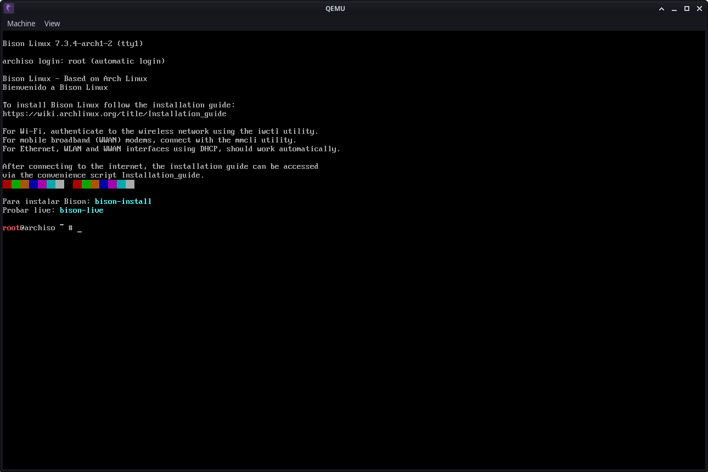
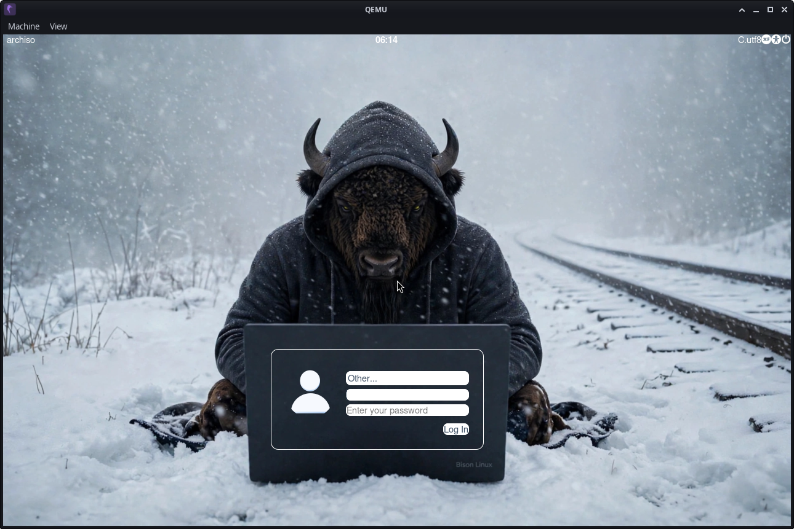
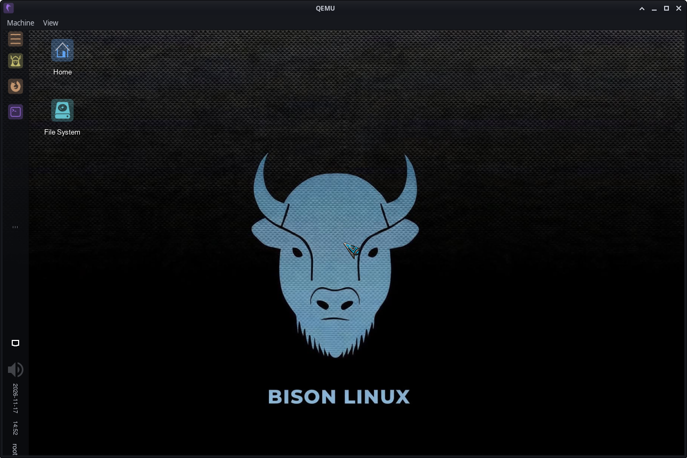
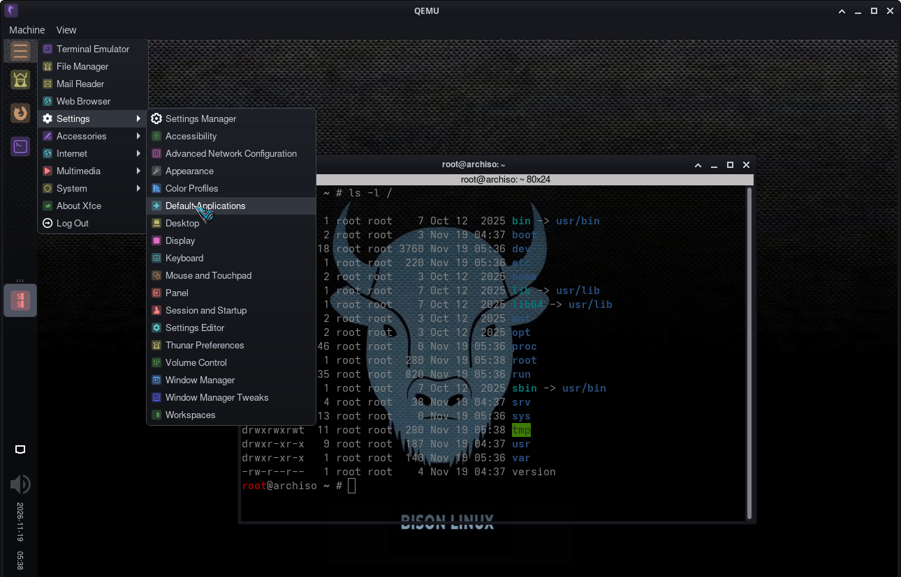
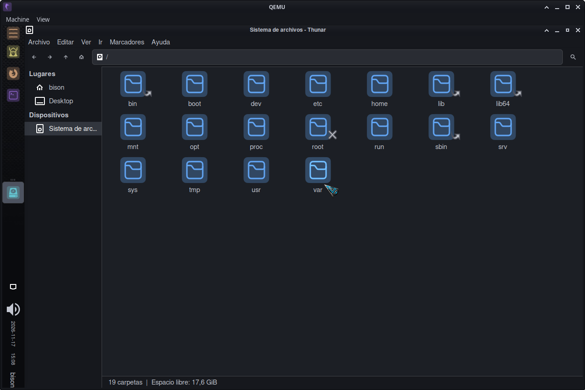

# BISON LINUX

Distro basada en Arch Linux con Xfce.

## Qué es

- Base: Arch Linux
- Entorno: XFCE mínimo.
- Instalador: `bison-install` - TUI con `dialog`
- Objetivo: sistema limpio, rápido.
- Enfoque: programación

## Requisitos

- CPU 64-bit
- UEFI o Legacy
- 2 GB RAM mínimo
- 30 GB disco mínimo
- Conexión a red durante la instalación

## Instalación

Booteá el ISO. Ejecutá:

```bash
bison-install
bison-live
```
Particionamiento
Tres modos.

Automático

- EFI/BIOS / swap / root / home

Guiado

- EFI/BIOS / swap / root / home

Experto

- Con cfdisk

Qué instala  
base, linux, linux-firmware  
networkmanager, grub, efibootmgr si UEFI  
xorg, xfce4, firefox.

Para instalar el gestor de energía:
- sudo pacman -S xfce4-power-manager

Para instalar un visor de imágenes:
- sudo pacman -S ristretto

Configuración de zona horaria:
- sudo timedatectl set-timezone Contoinente/País/Ciudad
- sudo timedatectl set-ntp true
- sudo hwclock --systohc

## Capturas

### 01 - Boot


### 02 - Login


### 03 - Escritorio


### 04 - Menú


### 05 - Thunar



Licencia GPL-3.0

---

Omar Carabajal - Sector 0  
Daireaux, Argentina - Buenos Aires  
15 de Noviembre 2026